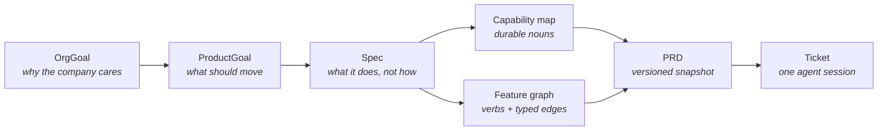
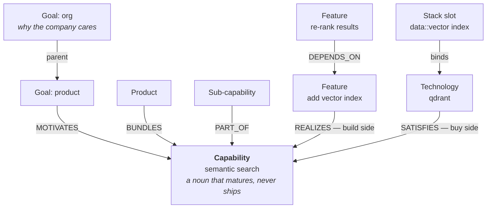
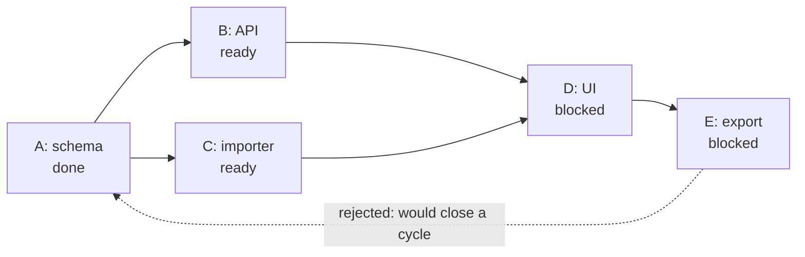
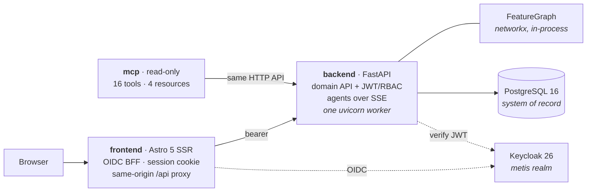

# metis

**Metis is a capability inventory shared across products.** Every product's user-facing
features are mapped to the capabilities built to implement them, and capabilities are
shared by name across products — so the question *what could we build next from what
already exists?* has a computed answer, not a meeting.

Downstream, the same graph turns intent into scoped, executable work: a pipeline from
why-the-company-cares down to a ticket sized to fit a single Claude session.

Named for the Titan of practical wisdom. The intelligence before the build.



## Why it exists

Roadmap tools model **work**. Work churns — so anything pinned to it rots. A PRD written
against a feature list is stale the week after it is approved, "why are we building this"
degrades into tribal memory, and a ticket that says *add auth* is unsizeable for a human
and unusable for an agent.

Metis makes one bet: **separate the durable nouns from the churning verbs.**

- A **capability** is what the product *can do* — a noun that matures and never ships.
- A **feature** is a user-facing *change* that realizes the capabilities it is built on —
  a verb that does ship, then archives. It belongs to one product; its capabilities
  may be shared with any number of others.

Because capabilities are stable, documents can pin to them permanently, provenance
becomes a pure graph traversal instead of a meeting, and a pivot rewrites the features
(cheap — they were meant to churn) while only re-weighting the map.

Everything else in the system is a consequence of that split.

## What you can ask it

The payoff is queries, not screens. All of these are live endpoints, all mirrored in
chat and over MCP:

| Question a PM actually asks | Where it comes from |
|---|---|
| What can we already do, and which products reuse it? | `GET /api/capabilities/inventory` |
| How much of this product idea already exists? | `POST /api/capabilities/coverage` |
| What breaks if we change this? | `GET /api/graph/impact/{feature_id}` |
| What can we start right now, with nothing blocking it? | `GET /api/graph/ready` |
| What order do we have to build these in? | `GET /api/graph/topo` |
| Why does this feature exist, all the way up to org intent? | `GET /api/features/{id}/why` |
| How far along is this capability, really? | `GET /api/capabilities/{id}/rollup` |
| Where is the taxonomy lying to us? | `GET /api/capabilities/health` |
| Do we build this or buy it? | `GET /api/capabilities/{slug}/supply` |
| What's the smallest cut that ships something? | `POST /api/graph/mvp-cut` |

No score is ever stored. If a number can be recomputed, it is recomputed — stored
derivations go stale, and a stale risk number is worse than none.

## Quick start

```sh
cp .env.example .env      # optional: add LLM provider keys
docker compose up --build
```

- Web: http://localhost:4321 — redirects to Keycloak login
- API: http://localhost:8000 (OpenAPI docs at /docs)
- Keycloak: http://localhost:8080 (admin console: `admin` / `admin`)

Seeded realm users (temporary passwords — Keycloak will force a change on first login):

| User | Password | Role |
|---|---|---|
| `admin@metis.local` | `admin` | admin (Settings: users, AI models, raw data) |
| `editor@metis.local` | `editor` | editor (read + write domain) |
| `viewer@metis.local` | `viewer` | viewer (read-only) |

For curl / seed scripts against the API without a browser session, set
`AUTH_ENABLED=false` in `.env` — every request becomes an admin on the desktop
surface, so writes work exactly as they do in the real app (see
[the write boundary](#the-write-boundary)). Leave it `true` for normal use.

A fresh instance is empty: metis holds only real data, loaded from seed files
exported from actual repositories (`metis-export`, then `metis-seed-instance`).
There is no demo data, and nothing a repo only describes — plans, specs, or code
it ships without running — is recorded as existing. The schema is `create_all` on boot — after pulling a
schema change, reset the dev volume (`docker compose down -v`). Realm import only
runs on a fresh Keycloak data directory; to re-import users/roles, recreate the
Keycloak container without a persisted volume (compose already does that).

The app runs with zero LLM keys — chat replies with a clear "provider not configured"
notice, and everything else works. Add any subset of provider credentials to `.env`
and pick provider + model per agent in **Settings → AI models**.

## The model

Four planes. The full spec is served live at `/ontology` and `GET /api/ontology/model`
(source: `backend/app/ontology/model.md`); the design record is in `docs/`.

| Plane | Node | Grammar | Lifecycle |
|---|---|---|---|
| **Why** | Goal | intent | own lifecycle |
| **What** (slow) | Capability | noun phrase — *semantic search* | matures, never ships |
| **Build** (fast) | Feature | verb phrase — *add vector index* | pending → in_progress → done |
| **Buy** | Technology | proper noun — *qdrant* | exists in the world independently of us |



**Capability is the exchange currency.** A feature `REALIZES` a capability — the *build*
side. A technology `SATISFIES` one — the *buy* side. Same node, same currency. Both
sides are many-to-many: a feature realizes every capability implementing it
(`feature_capabilities`, at least one), and a technology serves many. A feature's
product is its own (`features.product_id`), never derived from capabilities — a shared
capability says nothing about whose feature this is.

A product can be someone else's (`external`): you know its features as a user and
map them to the capabilities they need, declaring `unknown_capabilities` where you
can't tell. External products show what exists in the world; they never count as what
*we* can do — coverage of an idea counts only capabilities our own features realize. `GET /api/products/{id}/coverage` scores an existing product the same way: which of
its features we could build from what we have — a lower bound, since a feature with
unknown capabilities never counts as buildable. Alongside it, `known_covered` lists the
unknown-capability features whose every *named* capability is ours — a weaker signal.

**Journeys** (`/journeys`, `/api/journeys`) are ordered paths of features a person moves
through — inside one product or across several, ours or external. A step can also be one
nobody has built, named with the capabilities it would need. Each journey's analysis is
derived on every read through the same `coverage()` as the product score: per step, whether
it is live in one of our products today and whether it is buildable, covered as far as
anyone named, missing something, or unknown. Deleting a feature leaves its step as a
labelled gap.

Capability identity is the exact name (slug), on purpose: reuse is only visible when two
products name the same ability the same way. Coverage matches exactly and offers near
names as candidates; it never guesses, because a wrong match overstates what exists.

Goals motivate **capabilities**, never features directly — features inherit their
justification through `REALIZES`, which is what makes `why(feature)` a pure traversal
rather than a stored field someone has to maintain.

PRDs are versioned *snapshots* of the taxonomy — epics pin a capability, stories pin a
feature — never a second hierarchy.

### The slow plane — the capability map

A relational forest: `capabilities.parent_id` is `PART_OF`, single parent, cycle-guarded.
Capabilities carry stored `maturity` (planned → alpha → beta → ga → deprecated →
retired), facets, and evidence anchors. Their *progress* is never stored — it is always
the rollup over realizing features (`GET /api/capabilities/{id}/rollup`).

### The fast plane — the feature graph

Features and their typed edges (`DEPENDS_ON`, `BLOCKS`, `RELATES_TO`) live in Postgres,
mirrored into an in-memory networkx graph at startup. Every write commits to Postgres
first, then write-through updates the graph.

The **precedence graph** — `DEPENDS_ON ∪ reverse(BLOCKS)` — is what the interesting
queries run over. `RELATES_TO` is annotation only and is excluded from every algorithm.



Everything upstream is satisfied for **B** and **C**, so they are the ready frontier
(`/api/graph/ready`). **D** waits on both parents; **E** waits transitively. The dashed
edge is refused at write time — cycle detection runs on the write path, not as a report
you read afterwards.

### The buy plane — six questions

The technology catalog is **world-scope and opinion-free**: `technologies` holds
identity and classification, never a stance. The group's stance lives in `adoptions`
as an ordered ramp (`candidate → trial → adopted → standard`, demotion
`contained → deprecated → banned`), and *absence of a row is meaningful* — it means no
stance taken, not "neutral."

Stacks bind it all to products. A **stack slot** is `layer::role` with an optional
capability and an optional technology, and four predicates fall out of one row:

| Predicate | Means |
|---|---|
| `required AND tech_id IS NULL` | **gap** |
| two slots in one stack sharing `capability_id` | **redundancy** |
| `product_technologies.via_slot_id IS NULL` | **drift** — used but never declared |
| bound tech's `fit = 'workaround'` | **known ceiling** |

Six question endpoints share one envelope (`question`, `subject`, `answer`,
`unresolved`, `as_of`, `href`):

| Question | Endpoint |
|---|---|
| `capability_supply` — build or buy, in one frame | `GET /api/capabilities/{slug}/supply` |
| `tech_blast_radius` — what breaks if we drop this | `GET /api/tech/{slug}/blast-radius` |
| `tech_exposure` — what is dying, and does it matter | `GET /api/exposure?window_days=180` |
| `stack_redundancy` — one capability answered twice | `GET /api/stacks/{product}/redundancy` |
| `tech_encounters` — who has touched this | `GET /api/tech/{slug}/encounters` |
| `stack_recommend` — what should this stack be | `POST /api/stacks/{product}/recommend` |

**A gap is an answer.** An empty `answer` with a populated `unresolved` is the most
useful response the system gives — a capability nothing satisfies, a required slot no
offer survives for. It ships in the payload with a `200`; `404` means the *subject*
doesn't exist. `workaround` offers are graded, never hidden. The currently-bound
technology is never filtered out of a supply answer — you cannot re-evaluate a decision
you cannot see.

`stack_recommend` is deterministic end to end — supply, prune, rank — with no model in
the loop. If the ordering came out of a prompt, nobody could audit it and the same
question would answer differently on Tuesday.

### The write boundary

Read-only everywhere except the desktop. A write from any other surface returns:

```
403 { "error": "human_action_required",
      "message": "Binding a slot is a human action.",
      "href": "/stacks?slot=api::Auth" }
```

Not `401` — the caller is who they say. Not `405` — the route exists. The refusal names
the reason and hands over the screen that can act. Surface is derived from the token's
signed `azp`, so a service or MCP token cannot present itself as the desktop.

Nothing in this codebase binds a slot. An agent that can bind a slot can silence a gap,
and the gaps are the product.

## Architecture



| Service | Stack | Role |
|---|---|---|
| `frontend/` | Astro 5 (SSR, node adapter) + React islands | UI + OIDC BFF (session cookies, `/api/*` proxy with bearer). |
| `backend/` | FastAPI + SQLAlchemy 2.0 async | Domain API, JWT/RBAC, agents, in-memory feature graph. |
| `mcp` | MCP over stdio or SSE (compose profile `mcp`) | Read-only inventory and catalog answers for AI agents (see docs/mcp.md). |
| `keycloak` | Keycloak 26 | Identity provider (`metis` realm, admin/editor/viewer). |
| `postgres` | PostgreSQL 16 | System of record (JSONB PRD versions, ticket file arrays). |

Because the graph lives in process memory, the backend runs **exactly one uvicorn
worker** (encoded in the Dockerfile).

Cross-plane queries stitch it together: `GET /api/capabilities/{id}/impact` projects
feature dependencies onto capabilities, `GET /api/features/{id}/why` prints a feature's
provenance chain up to org intent, and `GET /api/capabilities/health` reports taxonomy
findings (aspirational gaps, unmotivated capabilities, empty intent).

### Agents

Chat routes each message through an orchestrator (keyword table first, LLM one-shot
second) to a specialist:

| Agent | Role |
|---|---|
| `spec_decomposer` | ProductGoal → Spec → PRD (Epics → Stories → Tickets, pinned to the taxonomy); enforces ticket sizing |
| `feature_manager` | Capability map + feature CRUD, `REALIZES`/`MOTIVATES` links, typed edges, duplicate-avoiding search; applies the noun/verb filing tests |
| `graph_agent` | Impact queries, build order, ready frontier, cycles, capability rollups, provenance chains, taxonomy health |
| `strategist` | RICE/MoSCoW priorities, versioned delivery strategies |

Agents call the same service functions as the REST API (one write path), stream over
SSE, and attach `ticket_card` viz blocks that render inline in the thread.

**Ticket sizing rule:** `context_budget` is S (single file), M (2–4 files), or
L (cross-cutting). A PRD cannot be approved while any ticket is L — split first. This is
the mechanism that makes "one ticket, one agent session" enforceable rather than
aspirational.

### MCP server

A read-only MCP surface for AI agents working for the portfolio owner ("how much of this
idea do we already have?", "how much of Strava could we build?") and for coding agents
mid-build ("does this package already have a stance?"). Connection steps and the full
tool list: [docs/mcp.md](docs/mcp.md). It calls the same **HTTP API** a browser
does — not the services in-process — so a chat transcript and an API log line up, and
the write boundary is inherited rather than re-implemented.

Sixteen tools. Eight answer inventory questions: `products`, `capability_inventory`,
`check_idea`, `product_score`, `capability`, `feature_why`, `journeys`, `ready_features`.
The other eight: the six `question` keys, plus `tech_search` (navigation — everything else
takes a slug it returns) and `propose_binding` (a hand-off that persists nothing).
Four resources: `metis://ontology/model`, `metis://policy/adoptions`, and the templated
`metis://tech/{slug}` and `metis://stacks/{product}`. Three prompts.

Tools return **text, not JSON** — an agent quotes text back to a user but paraphrases
JSON, and paraphrase is where `workaround` quietly becomes "partial support."

```sh
docker compose --profile mcp up -d mcp  # SSE on 127.0.0.1:8001
```

The server refuses to start SSE without `MCP_SSE_TOKEN`: it holds an API token, and an
open port would lend it to anyone who can reach the address.

**Claude Code plugin.** [`plugin/`](plugin/README.md) brings this server to a coding
session in any repo, with skills that check for reuse before building
(`metis-check-idea`, `metis-find-reuse`, `metis-what-next`) and read-only hooks: a
product brief at session start, a one-line nudge when a prompt names a capability another
product already has, and a reminder to re-export the seed file after code changes. The
repo root is its marketplace:

```
/plugin marketplace add /path/to/metis
/plugin install metis@metis
```

### LLM providers

Anthropic API, OpenAI, OpenRouter, AWS Bedrock (Claude), and Ollama (local) sit behind
one streaming protocol. Availability is detected from credentials in the environment
(Ollama via a live reachability probe); per-agent provider + model selection is
DB-backed and editable in Settings → AI models.

## Seed workflows

Metis supports both **in-app** and **skill-driven** seed round-trips (seed file format:
`backend/app/ontology/seed-format.md`):

- In the **Products** page, admins/editors can:
  - **Export seed**: download the selected Spec as a `metis-seed/v1` JSON file,
    including its attributed goals, capabilities, features, edges, and optional PRD.
  - **Import seed**: paste or upload a `metis-seed.json`, run a dry-run validation,
    then import it with the same **idempotent, add-only** identity rules as the
    seed loader.
- Imports validate the seed shape before writing anything, show reuse/create counts,
  and surface expected notes/warnings such as "product already has a PRD".

### Claude Code skills

The metis Claude Code plugin (`plugin/`) ships three skills for seeding an
instance from real codebases (using the same seed format and add-only semantics
as the in-app flow):

- `plugin/skills/metis-seed-instance` loads a `metis-seed.json` into the running
  instance via the API: idempotent, add-only. `plugin/skills/metis-unseed`
  removes what a seed file created. With auth enabled, either use a browser session through the UI, set
  `AUTH_ENABLED=false`, or pass a bearer token.
- `plugin/skills/metis-export` analyzes *any* repository and writes a `metis-seed.json`.
  To use it from other repos, symlink it into your global skills once per machine:

  ```sh
  ./scripts/install-skills.sh
  ```

For scripted/manual verification after an import:

```sh
curl -s http://localhost:8000/api/capabilities/map
curl -s http://localhost:8000/api/graph/ready
curl -s http://localhost:8000/api/capabilities/health
```

Admins can also browse and cascade-delete ontology rows directly at `/data` — the one
place that overrides the domain invariants, for cleaning up orphaned seed data.

## Configuration

All optional — see `.env.example`:

| Variable | Purpose |
|---|---|
| `ANTHROPIC_API_KEY` | Anthropic API |
| `OPENAI_API_KEY` | OpenAI |
| `OPENROUTER_API_KEY` | OpenRouter |
| `AWS_ACCESS_KEY_ID` / `AWS_SECRET_ACCESS_KEY` / `AWS_REGION` | Bedrock (Claude models) |
| `OLLAMA_BASE_URL` | Ollama; compose default reaches host Ollama at `host.docker.internal:11434` |
| `AUTH_ENABLED` | `false` makes every request an admin on the desktop surface — scripts only |
| `METIS_MCP_SSE_TOKEN` | Required for the MCP server's SSE mode |
| `ANTHROPIC_MODELS` etc. | Override the model dropdowns (comma-separated) |

## Development

```sh
# database
docker compose up -d postgres

# backend (Python 3.11+)
cd backend
python3 -m venv .venv && .venv/bin/pip install -r requirements-dev.txt
.venv/bin/uvicorn app.main:app --reload --port 8000

# tests (uses a metis_test database on the compose postgres)
.venv/bin/python -m pytest

# frontend
cd frontend
npm install
npm run dev            # http://localhost:4321, proxies to localhost:8000
```

## Design system

The UI implements the Metis design system: warm paper neutrals with one Aegean-blue
accent, Space Grotesk + IBM Plex Mono, hairline-first cards, pipeline-stage hues, a
1–5 priority ramp, and S/M/L budget colors. Design tokens are in
`frontend/src/styles/tokens/`; components in `frontend/src/ds/`. System state renders
verbatim in mono (`in_progress`, `DEPENDS_ON`, `workaround`) — never prettified, so a
screenshot, a log line and a chat transcript stay greppable against each other.

## Repository layout

```
backend/
  app/models/      Goal, Capability, Feature, Product, Technology, Stack, work, governance
  app/routers/     Domain API + the six question endpoints + admin data browser
  app/services/    graph, capabilities, decomposition, technologies, stacks, seed
  app/agents/      orchestrator, prompts, SSE runner, tools
  app/mcp/         read-only MCP server (stdio + SSE)
  app/ontology/    model.md — served to the UI, the API and MCP from one file
frontend/          Astro app: pages, React islands, design system (ds/), API proxy
docs/              ontology design record (divergence, mental model, graph spec)
plugin/skills/     metis-export, metis-seed-instance, metis-unseed (Claude Code plugin)
docker-compose.yml
```
